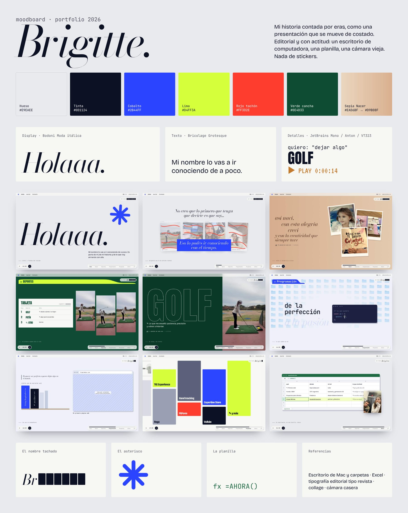

# Portfolio de Brigitte



Una presentación que se scrollea para el costado. Va contando mi historia en eras y mi nombre se revela de a una letra.

**Stack:** Next.js 16 (App Router) + TypeScript + Tailwind 4 + GSAP (ScrollTrigger) + Lenis. Es bilingüe: `/es` y `/en`.

## Moodboard

**Idea:** mi historia contada por eras, como una presentación que se mueve de costado. Es editorial y tiene actitud. Los objetos que la arman son un escritorio de computadora, una planilla y una cámara vieja. Nada de stickers ni "nena".

| Color | Hex | Dónde se usa |
|---|---|---|
| Hueso | `#E9EAEE` | fondo base |
| Tinta | `#0D1124` | texto y el nombre tachado |
| Cobalto | `#2B44FF` | acento principal, el asterisco, el contacto |
| Lima | `#D4FF3A` | resaltados (la fila de "ahora" en la planilla, la selección de texto) |
| Rojo tachón | `#FF3D2E` | las tachaduras de las etiquetas |
| Verde cancha | `#0E4D33` | la era Deportes |
| Sepia | `#EAD6BF` → `#D9B08F` | la era Nacer, nostálgica |

**Tipografías:**
- **Bodoni Moda** (itálica) para los títulos grandes ("Holaaa.", "Brigitte").
- **Bricolage Grotesque** para el texto.
- **JetBrains Mono** para las notas de presentador.
- **Anton** para Deportes.
- **VT323** para la cámara de Nacer.

**Motivos:**
- El nombre tachado (B██████), que se destapa letra por letra a medida que pasás de era.
- El asterisco cobalto.
- La planilla que termina en `=AHORA()`.
- La cámara casera de Nacer.

**Referencias:** el escritorio de Mac con sus carpetas, Excel, la tipografía editorial de revista, el collage y la cámara casera.

## Correrlo

```bash
npm install
npm run dev        # http://localhost:3000  → redirige a /es o /en según el navegador
```

Para subirlo: hacé push a GitHub e importalo en Vercel. No necesita configuración.

## Dónde va cada cosa

### Fotos: soltalas en la carpeta y aparecen solas

| Carpeta | Qué va | Cuántas |
|---|---|---|
| `public/fotos/avatar/` | fotos tipo avatar para golfista, programadora, estudiante y "pienso mucho" (en ese orden) | 4 |
| `public/fotos/nacer/` | fotos de chiquita (la 4ª es el fondo si no hay video) | 3–4 |
| `public/fotos/deportes/` | golf, patín… (la 5ª va adentro de la pulsera) | 5 |
| `public/fotos/programacion/` | screenshot de tu primera web | 1 |
| `public/fotos/proyectos/` | una por proyecto, **con el mismo nombre que su `id`**: `hunda.jpg`, `trak.png`… | opcional |
| `public/fotos/ahora/` | una foto tuya de hoy (aparece en la planilla) | 1 |
| `public/fotos/contacto/` | la foto tirando un beso 💋 | 1 |
| `public/video/cumple.mp4` | el video de "hoy es mi cumpleaños" | 1 |

Se ordenan por nombre, así que podés llamarlas `1.jpg`, `2.jpg`, etc.
Si son **.HEIC** (del iPhone), corré `npm run fotos` y se convierten a JPG.

### Textos

- **`src/content/site.ts`** tiene todo el texto en español e inglés, las canciones de cada era, el transcript del video y las notitas de cada diapositiva. Buscá `✎` para ver lo que falta completar.
- **`src/content/projects.ts`** tiene los proyectos (el muro tipo Pinterest) y la planilla de experiencia.
- Para el transcript del video, cada frase tiene un `at` con el segundo del video en que aparece.

### Journal

Cada entrada es un archivo en `src/content/journal/`:

```
mi-entrada.es.mdx   ← obligatorio
mi-entrada.en.mdx   ← opcional (si falta, muestra la versión en español con un aviso)
```

Arriba del archivo:

```yaml
---
title: Título
date: 2026-10-14
kind: post        # post | fotos | video
cover: /fotos/journal/portada.jpg   # opcional
excerpt: Una línea para la lista
---
```

Adentro podés usar `<Nota>…</Nota>` (un post-it), `<Fotos>…</Fotos>` (una grilla de fotos) y `<Video src="/video/x.mp4" />`.

## Cómo funciona (para cuando quieras tocarlo)

- `src/components/Track.tsx` es el carrete. Fija la pantalla, convierte el scroll vertical en movimiento horizontal y maneja las flechas del teclado, los botones ← → y la barra de eras.
- `src/components/Panel.tsx` es una diapositiva. Tiene dos opciones:
  - `hold={1.5}`: la diapositiva se queda quieta 1,5 pantallas de scroll mientras pasa algo adentro (el tipeo, la planilla).
  - `wide="auto"`: la diapositiva mide lo que mida su contenido (por ejemplo, el muro de proyectos).
  - Adentro, `usePanel(({ enter, hold, through, exit }) => …)` te da el progreso (de 0 a 1) para animar.
- `nameStep` en un Panel indica cuántas letras del nombre se ven a partir de esa diapositiva. Los valores están en `NAME_STEPS`, en `site.ts`.
- Si la persona tiene "reducir movimiento" activado, todo se ve vertical y quieto.
